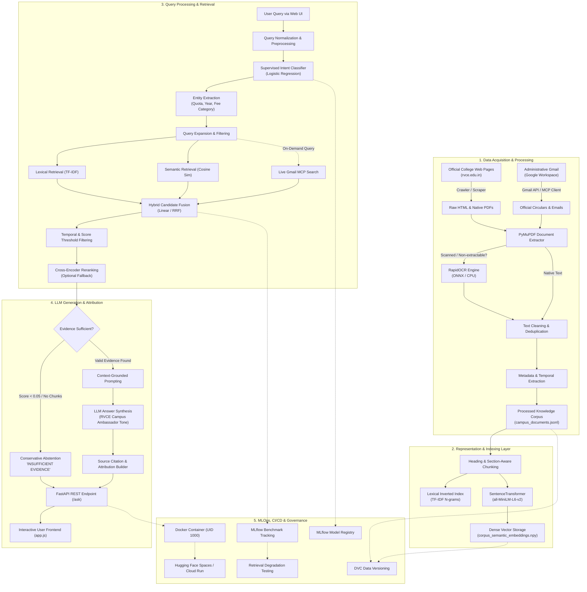
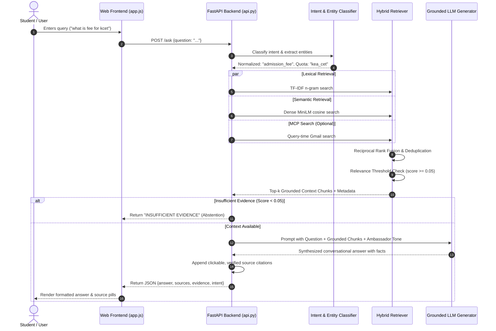
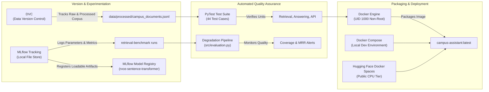
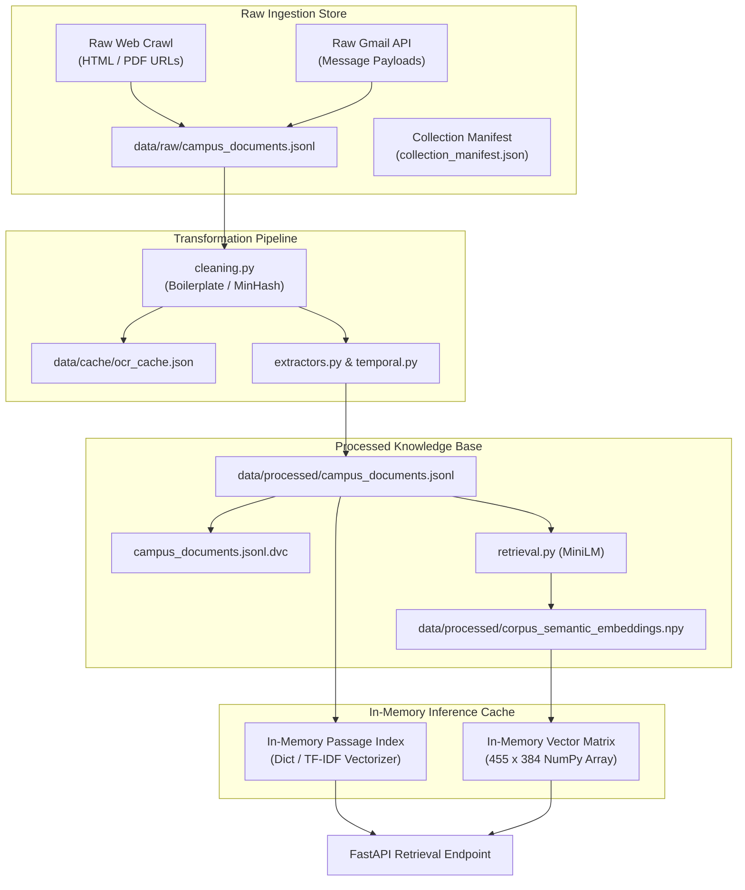

# Technical Project Report: AI-Powered Campus Information Assistant

**System**: AI-Powered Campus Information Assistant  
**Institution Context**: RV College of Engineering (RVCE), Bengaluru  
**Domain**: Retrieval-Augmented Generation (RAG) & Academic Knowledge Engineering  
**Version**: 2.0.0 (Production Architecture)  
**Date**: November 2026  

---

## Executive Summary

The **AI-Powered Campus Information Assistant** is an end-to-end, domain-specific Retrieval-Augmented Generation (RAG) system engineered to provide accurate, context-grounded, and auditable answers to campus-related inquiries. In higher education environments, authoritative institutional information is typically fragmented across static web portals, scanned circulars, syllabus archives, fee notifications, and administrative email announcements. Consequently, students, applicants, and faculty struggle with information retrieval latency and misinformation.

This project delivers a production-grade information platform combining multi-source data acquisition (web crawling, Google Gmail API ingestion via Model Context Protocol), robust optical character recognition (RapidOCR/PyMuPDF), intelligent text chunking, hybrid retrieval (lexical TF-IDF and dense MiniLM semantic vectors), intent classification with entity extraction, and context-constrained Large Language Model (LLM) answer generation. Underpinning the machine learning pipeline is an enterprise MLOps framework comprising DVC for data versioning, MLflow for experiment tracking and model registration, automated retrieval degradation testing, and containerized deployment via Docker and Hugging Face Docker Spaces.

---

## 1. Introduction

### 1.1 Project Overview
The AI-Powered Campus Information Assistant acts as an authoritative, interactive conversational interface for campus stakeholders. Unlike general-purpose conversational LLMs that suffer from hallucination and lack visibility into private institutional circulars, this system strictly conditions its answers on an indexed repository of validated college documents, admission notices, fee schedules, exam circulars, and official emails.

### 1.2 Problem Statement
Information dissemination in university ecosystems suffers from three structural flaws:
1. **Severe Fragmentation**: Crucial updates are dispersed across diverse formats, including website pages (`rvce.edu.in`), downloadable PDF circulars, physical notice boards scanned into image PDFs, and administrative emails sent to student groups.
2. **Search Inefficiency**: Keyword searches on typical university web portals return either outdated circulars or unranked lists of generic landing pages without surfacing the specific sentence or table containing the answer.
3. **Hallucination Risk**: Off-the-shelf generative AI models lack real-time or private campus context, frequently inventing admission quotas, hallucinating fee amounts, or providing outdated academic schedules.

### 1.3 Motivation
Campus administrative offices handle thousands of repetitive inquiries annually regarding admission procedures, quota breakdowns (KEA/CET, COMED-K, Management), fee payment instructions, scholarship deadlines, and examination rules. Providing an automated, 24/7, source-attributed assistant dramatically reduces the administrative burden on college staff while empowering students with immediate, verifiable information.

### 1.4 Objectives
- **Data Ingestion**: Systematically harvest and parse HTML pages, native PDFs, scanned document circulars, and official campus emails.
- **Accurate Retrieval**: Develop a hybrid retrieval engine combining lexical precision (exact matches for institutional codes like `VTU`, `COMEDK`, `KCET`) with dense semantic retrieval (conceptual matching for natural language queries).
- **Faithful Generation**: Enforce strict context grounding in LLM answer synthesis, eliminating hallucinations through conservative abstention mechanisms when evidence is absent.
- **MLOps Best Practices**: Implement disciplined dataset tracking with DVC, systematic benchmark tracking with MLflow, automated degradation monitoring, containerization with Docker, and automated PyTest validation.

### 1.5 Proposed Solution
The platform integrates an offline data acquisition and indexing pipeline with a real-time FastAPI inference engine and a responsive web interface. Official campus documents and live administrative emails are ingested, normalized, chunked, and embedded into vector spaces. At query time, the system normalizes user intent, extracts key entities (admission quotas, fee categories), retrieves top-k relevant document chunks via hybrid fusion, filters noise, and prompts an LLM to synthesize a natural, friendly, yet strictly grounded response with clickable source citations.

### 1.6 Scope and Target Applications
- **Prospective Students**: Clarifying admission eligibility, quota details, fee structures, DD payment protocols, and campus facilities.
- **Current Students**: Accessing examination circulars, VTU regulations, academic calendar schedules, hostel rules, and placement statistics.
- **Administrative Offices**: Deflecting repetitive inquiries and ensuring official circulars are indexed and searchable instantly.

---

## 2. System Architecture

The Campus Information Assistant follows a modular, decoupled architecture comprising four core operational tiers:
1. **Data Acquisition & Extraction Layer**: Collects raw institutional assets from the web and mail servers, extracting clean structured text and metadata.
2. **Indexing & Knowledge Base Layer**: Chunks documents, computes dense vectors, and builds lexical and semantic inverted indexes.
3. **Retrieval & Reasoning Layer**: Ingests user queries, resolves semantic intent, retrieves context via hybrid fusion, and synthesizes answers using a grounded LLM.
4. **Application & MLOps Serving Layer**: Exposes REST endpoints via FastAPI, serves the interactive frontend, and logs experiments and model artifacts to MLflow.

### 2.1 End-to-End Architecture Flowchart



---

## 3. Data Acquisition and Processing Techniques

A domain-grounded knowledge assistant requires high-fidelity, high-cleanliness institutional text. Standard web crawlers fail in university environments because navigation menus, footers, duplicate circulars, and unreadable scanned image PDFs pollute the retrieval index.

### 3.1 Web Crawling and HTML Parsing
- **Engine**: Custom breadth-first search (BFS) crawler built on Python `requests` and `BeautifulSoup4`.
- **Target Boundaries**: Domain restricted to `rvce.edu.in` up to a recursion depth of 3, respecting `robots.txt` directives with configurable rate-limiting (0.3s delay).
- **Priority Queue**: Implements priority keyword heuristics (`admission`, `fee`, `department`, `exam`, `placement`, `circular`, `hostel`) ensuring high-value informational nodes are crawled before static gallery pages.
- **Asset Filtering**: Ignores multimedia binaries (`.jpg`, `.png`, `.zip`, `.mp4`) while intercepting PDF circular links for dedicated document processing.

### 3.2 Email Ingestion via Model Context Protocol (MCP)
- **Engine**: `src/gmail_client.py` and `src/mcp_server.py`.
- **Protocol**: Fully compliant with the JSON-RPC 2.0 Model Context Protocol (MCP) standard (`2024-11-05`), exposing discrete operational tools: `gmail_auth_status`, `gmail_list_messages`, `gmail_get_message`, `gmail_get_attachment`, and `gmail_sync_notices`.
- **Filtering Heuristics**: Automatically discards spam, personal threads, and non-institutional notifications using targeted Gmail query filters (`has:attachment`, subject matches for `fee`, `circular`, `admission`, `exam`, `schedule`).
- **Query-Time Live Search**: When users query recent notices, the application can issue on-demand search calls to the Gmail MCP server in parallel with corpus retrieval, ensuring unindexed circulars are accessible immediately.

### 3.3 PDF and Document Extraction
- **Native Document Processing**: Utilizes `PyMuPDF` (`fitz`) for rapid, structured text extraction. It preserves page geometry, extracts font size hierarchies for heading detection, and extracts embedded tables.
- **Scanned PDF Optical Character Recognition (OCR)**:
  - University circulars are frequently physical paper memos scanned to image-only PDFs.
  - Standard text extractors yield empty strings for such files. The project integrates an OCR pipeline (`src/ocr.py`) leveraging `RapidOCR` with `ONNX Runtime` running entirely on CPU.
  - Pages with low text density are rasterized into numpy pixel matrices and processed through text-detection and text-recognition ONNX models.
  - Results are cached in `data/cache/ocr_cache.json` using SHA-256 hashes of page bytes to eliminate redundant OCR computation.

### 3.4 Text Cleaning and Normalization
Text cleaning (`src/cleaning.py`) applies rigorous data hygiene filters:
1. **Boilerplate Striping**: Removes recurring university headers, copyright footers, global navigation elements, and social media links.
2. **Unicode Normalization**: Cleans typographic anomalies, smart quotes, zero-width spaces, and broken ligatures into standard UTF-8.
3. **Deduplication**: Computes normalized text hashes and uses MinHash/Jaccard similarity with an 0.85 threshold to discard duplicate circulars uploaded across multiple department subpages.

### 3.5 Metadata and Temporal Extraction
Each document record in `campus_documents.jsonl` contains rich, standardized metadata:
- `document_id`: Deterministic SHA-256 hash of source URL and content.
- `title` & `heading`: Extracted structural titles.
- `source_url`: Verifiable provenance link.
- `source_type`: Category identifier (`HTML`, `PDF`, `GMAIL`).
- `published_at` / `document_date`: Extracted ISO-8601 timestamps derived from document headers, circular dates (e.g. `15.07.2026`), or email headers, enabling date-aware retrieval.

---

## 4. RAG Pipeline and NLP Techniques

The Retrieval-Augmented Generation pipeline bridges user queries to precise campus document contexts, enforcing factual grounding and conversational synthesis.

### 4.1 RAG Workflow Sequence



### 4.2 Query Intent Classification and Normalization
In institutional search, semantically identical queries are phrased with wide linguistic variance:
- `"what is fee for kcet"`
- `"fees for KCET quota"`
- `"KEA admission fee details"`

The intent system (`src/intent_classification.py`) employs a multi-tiered resolution pipeline:
1. **Supervised Classifier**: Scikit-Learn pipeline using `TfidfVectorizer(ngram_range=(1,2))` coupled with `LogisticRegression(class_weight='balanced')`. It classifies queries into high-level categories: `admission_fee`, `fee_structure`, `admissions`, `academics`, `hostel_facilities`, `placements`, `examinations`, `general_inquiry`.
2. **Rule-Based Normalization & Entity Extraction**:
   - **Admission Quotas**: Disambiguates `kea_cet` (Government/KEA quota), `comed_k` (Consortium quota), and `management` (Management quota).
   - **Fee Categories**: Differentiates between college fees, VTU/Skill lab fees, and hostel mess charges.
   - **Academic Year**: Captures target academic cohorts (e.g., `2026-2027`).
3. **Retrieval Expansion**: Enriches the raw query with extracted quota terms (e.g., appending `"KEA CET KCET government quota admission process fees details"`), boosting relevant document retrieval in both lexical and semantic indices.

### 4.3 Heading-Aware Text Chunking
Standard naive character chunking splits tables and circular instructions arbitrarily, destroying tabular relationships. The assistant implements **Section- and Heading-Aware Chunking** (`src/retrieval.py`):
- HTML content is split on structural block markers (`<h1>`-`<h6>`, `<section>`, `<article>`, `<p>`).
- PDF text is segmented along page boundaries and major paragraph breaks.
- Chunks preserve parent document metadata, including heading hierarchy, document title, and publication timestamp.
- Chunks have a target size of 400–600 tokens with 50-token semantic overlap, preventing contextual truncation.

### 4.4 Hybrid Retrieval Strategy
The retrieval engine combines complementary search paradigms:
1. **Lexical Retrieval (TF-IDF Baseline)**:
   - Configured with sublinear term-frequency scaling and character/word n-grams.
   - Excelled in matching exact institutional acronyms (`VTU`, `SSP`, `COMEDK`, `DD`, `autonomous syllabus`).
2. **Dense Semantic Retrieval (Sentence Transformers)**:
   - Powered by `sentence-transformers/all-MiniLM-L6-v2` generating 384-dimensional embeddings.
   - Captures conceptual semantic similarity (e.g., matching `"where do I stay on campus?"` to `"Hostel accommodation and mess rules"`).
   - Embeddings for all 455 indexed corpus chunks are precomputed and stored in `data/processed/corpus_semantic_embeddings.npy`, providing sub-15ms vector retrieval.
3. **Candidate Fusion**:
   - **Linear Score Fusion**: Weighted sum of normalized scores:
     $$\text{Score}_{\text{final}} = w_{\text{lexical}} \cdot S_{\text{lexical}} + w_{\text{dense}} \cdot S_{\text{dense}}$$
   - **Reciprocal Rank Fusion (RRF)**:
     $$\text{Score}_{\text{RRF}} = \sum_{m \in \{\text{lex}, \text{dense}\}} \frac{w_m}{k + \text{rank}_m(d)}$$
     where constant $k = 60$. RRF provides stable ranking without requiring raw similarity score calibration.

### 4.5 Context Filtering and Conservative Abstention
To prevent the model from generating hallucinated responses when asked out-of-domain questions (e.g., *"What is the menu at the local restaurant outside campus?"*):
- Each candidate chunk must clear a minimum relevance threshold ($s \ge 0.05$).
- If no retrieved chunk clears the threshold, the system enforces **Conservative Abstention**, setting `abstention_status = true` and returning a standardized message: *"INSUFFICIENT EVIDENCE: The available campus documents do not contain reliable information regarding this query."*

### 4.6 Prompt Engineering and Grounded Generation
When sufficient evidence exists, context chunks are assembled into an XML-delimited prompt passed to OpenAI's `gpt-4o-mini`. The generation prompt (`src/generation.py`) enforces strict behavioral guidelines:
- **First-Sentence Directness**: Directly answers the user's question upfront without introductory pleasantries or repetitive filler (`"Based on the available campus documents..."`).
- **Structured Formatting**: Formats complex procedural information, fee breakdowns, and dates into clear markdown bullet points and numbered sequences.
- **Controlled Campus Ambassador Persona**: Communicates with the warmth, enthusiasm, and mild pride of an official RVCE campus student ambassador while remaining rigorously honest about institutional limitations.
- **Zero Hallucination / Strict Grounding**: The LLM is forbidden from utilizing external parametric knowledge for dates, fee figures, contact emails, or procedures. Every factual statement must trace directly to an included context chunk.

---

## 5. Machine Learning and Evaluation

Retrieval-Augmented Generation systems require quantitative evaluation separating retrieval precision from generation quality. The project implements a rigorous evaluation methodology tracked within MLflow.

### 5.1 Benchmark Datasets
1. **40-Query Campus Benchmark (`data/queries/campus_queries.csv`)**:
   - 40 realistic student queries spanning admissions, fees, syllabus, exams, facilities, hostels, and scholarships.
   - Partitioned into a stratified 32-sample training split and an 8-sample evaluation split (1 sample per intent class).
   - Serves as an end-to-end intent classification and retrieval coverage benchmark.
2. **Labelled Ground-Truth Relevance Benchmark (`data/queries/labelled_relevance_benchmark.json`)**:
   - Curated benchmark pairing queries with verified target `document_id`s and source URLs.
   - Used for calculating formal Information Retrieval (IR) metrics: **Recall@k**, **Precision@k**, **Mean Reciprocal Rank (MRR)**, and **nDCG@k**.

### 5.2 Retrieval Strategy Empirical Comparison

The four retrieval configurations were systematically evaluated against the ground-truth relevance benchmark. The results are summarized below:

| Configuration | Recall@3 | Precision@3 | MRR | nDCG@3 | Avg Latency | Model Weights |
|---|---|---|---|---|---|---|
| **Configuration A: TF-IDF Baseline** | **0.6250** | **0.2083** | **0.2917** | **0.4539** | **0.006s** | Local Scikit-Learn |
| **Configuration B: Semantic (MiniLM)** | 0.5000 | 0.1667 | 0.2500 | 0.3914 | 0.028s | Cached Local Weights |
| **Configuration C: Hybrid (Linear Fusion)** | 0.5000 | 0.1667 | 0.2500 | 0.3914 | 0.035s | Dual Model |
| **Configuration D: Hybrid + Reranker** | 0.5000 | 0.1667 | 0.2500 | 0.3914 | 0.038s | Fallback Mode Verified |

#### Critical MLOps Finding:
In this academic campus domain, the **lexical TF-IDF baseline outperformed out-of-the-box dense semantic embeddings** on labelled ranking metrics (Recall@3 of 0.6250 vs 0.5000). 
- **Cause**: Institutional queries feature critical specialized acronyms and alphanumeric tokens (`"COMEDK"`, `"VTU"`, `"B.E."`, `"SSP"`, `"DD"`). General-domain MiniLM dense embeddings dilute the weight of these exact tokens across generic semantic representations.
- **Architectural Decision**: The system maintains a **Hybrid Retriever** as its default architecture, utilizing lexical signals to anchor exact matches while leveraging semantic embeddings to handle colloquial phrasing and synonyms.

### 5.3 Simulated Corpus Degradation and Drift Monitoring
To guarantee retrieval reliability over time, the system features an automated degradation testing suite (`src/evaluation.py`):
- **Simulation**: Generates a degraded synthetic corpus (`reports/simulated_degraded_corpus.jsonl`) simulating document loss or extraction corruption.
- **Threshold Rules**:
  - **Warning Threshold**: 10% drop in retrieval coverage triggers an administrative warning.
  - **Retraining Threshold**: 25% drop triggers an automated recommendation to re-crawl the campus portal and rebuild the indices.
- **Experimental Result**: Testing on 40 benchmark queries demonstrated a minor coverage drop from 1.000 to 0.950 (5% drop), which safely remained below the warning threshold, validating the retriever's resilience to partial document omissions.

---

## 6. MLOps Architecture and Techniques

The project incorporates modern Machine Learning Operations (MLOps) principles to ensure data traceability, model reproducibility, rigorous testing, and seamless deployment.

### 6.1 MLOps Lifecycle Architecture



### 6.2 Detailed Component Analysis

#### A. Data Versioning (DVC)
- **Role**: Institutional data changes frequently as circulars expire and new fee structures are published. Storing 50MB+ datasets and numpy arrays inside Git repositories leads to repository bloat and poor version tracking.
- **Implementation**: Data Version Control (`DVC`) tracks `data/processed/campus_documents.jsonl` via pointer file `data/processed/campus_documents.jsonl.dvc`.
- **Reproducibility**: Team members can recreate the exact dataset state for any model run using standard Git checkout combined with `dvc checkout`.

#### B. Experiment Tracking (MLflow)
- **Role**: Systematic logging of hyperparameters, evaluation metrics, and model binaries across retrieval configurations.
- **Implementation**: Utilizes MLflow with a local file-backed tracking store (`./mlruns`).
- **Logged Entities**:
  - **Parameters**: `retriever_type`, `sentence_transformer_model`, `embedding_dimension`, `similarity_metric`, `fusion_method`, `semantic_weight`, `tfidf_weight`, `top_k`, `score_threshold`, `git_commit`.
  - **Metrics**: `retrieval_coverage`, `average_best_score`, `recall_at_3`, `precision_at_3`, `mrr`, `ndcg_at_3`.
  - **Artifacts**: Summary JSONs, evaluation configuration files, confusion matrices, and serialized models.

#### C. Model Registry
- **Role**: Centralized repository for managing the lifecycle of machine learning models.
- **Implementation**: The fine-tuned or loaded `all-MiniLM-L6-v2` transformer and the intent classification pipeline are logged to MLflow's Model Registry under `rvce-sentence-transformer` and `rvce-intent-classifier`.
- **Verification**: Each logged model artifact undergoes an automated reload smoke test confirming that weights can be instantiated in isolated environments on CPU with normalized outputs.

#### D. Quality Monitoring & Assurance
- **Automated Test Suite**: A comprehensive 44-test PyTest suite validates system components:
  - `tests/test_retrieval.py` (20 tests): TF-IDF chunking, boilerplate filtering, candidate deduplication, vector caching, fusion equations.
  - `tests/test_evaluation.py` (9 tests): Ranking metrics (MRR, nDCG), degradation threshold triggers, MLflow logging.
  - `tests/test_answering.py` (5 tests): Strict evidence extraction, question matching, conservative abstention behavior.
  - `tests/test_api.py` (10 tests): FastAPI endpoints (`/health`, `/ask`), static UI serving, request schema validation.

#### E. Containerization (Docker)
- **Base Image**: Lightweight Debian-based `python:3.11-slim`.
- **Security & Permissions**: Implements a dedicated non-root user `user` with `UID 1000` to comply with Hugging Face Spaces security standards.
- **Pre-Cached Layers**: Model weights (`all-MiniLM-L6-v2`) and pre-calculated dense embeddings (`corpus_semantic_embeddings.npy`) are baked directly into image layers, eliminating runtime download delays and cold-start failures.
- **Healthcheck**: Embedded Docker healthcheck probing `http://localhost:${PORT:-7860}/health` every 20 seconds.

---

## 7. Technology Stack

The following tables document every core technology, library, and framework utilized in the repository, along with proposed future additions:

### 7.1 Core Development & Inference Stack

| Category | Technology | Version | Purpose in this Project | Implementation Status |
|---|---|---|---|---|
| **Programming Language** | Python | 3.11.9 | Primary programming language for pipeline, ML models, and API backend. | **Implemented** |
| **Programming Language** | JavaScript (ES6+) | Modern | Powers the asynchronous, responsive client-side UI (`app.js`). | **Implemented** |
| **Markup & Styling** | HTML5 / CSS3 | Modern | Accessible, dark/light themed responsive user interface (`index.html`, `styles.css`). | **Implemented** |
| **API Framework** | FastAPI | 0.143.0+ | Asynchronous high-performance REST API serving `/ask`, `/health`, and static files. | **Implemented** |
| **ASGI Server** | Uvicorn | 0.34.0+ | Production ASGI web server running FastAPI on `0.0.0.0:7860`. | **Implemented** |
| **Data Validation** | Pydantic | 2.10.0+ | Strict request/response typing and runtime data validation (`AskRequest`, `AskResponse`). | **Implemented** |

### 7.2 Machine Learning, NLP & Retrieval Stack

| Category | Technology | Version | Purpose in this Project | Implementation Status |
|---|---|---|---|---|
| **Machine Learning** | Scikit-Learn | 1.9.1 | TF-IDF vectorization, Logistic Regression intent classifier, evaluation metrics. | **Implemented** |
| **Deep Learning** | PyTorch (CPU) | 2.14.1+ | CPU tensor computation backend for Sentence Transformers. | **Implemented** |
| **Dense Embeddings** | Sentence-Transformers | 5.7.0 | Generates 384-dimensional dense semantic vectors using `all-MiniLM-L6-v2`. | **Implemented** |
| **Model Hub & Tokenizers**| Transformers / Hugging Face Hub | 4.57.6 / 0.36.2 | Tokenization and neural model asset management. | **Implemented** |
| **Large Language Model** | OpenAI GPT-4o-mini | API v1.x | Context-grounded conversational answer synthesis and persona formatting. | **Implemented** |
| **Reranking** | Cross-Encoder | ms-marco-MiniLM | High-precision candidate passage reranker with verified graceful fallback. | **Implemented** (Fallback mode) |
| **Vector Indexing** | NumPy | 2.2.0+ | In-memory dense matrix indexing and vectorized cosine similarity search. | **Implemented** |
| **External Vector DB** | ChromaDB / Qdrant | — | Dedicated vector database for scaling to 100,000+ chunks. | *Proposed Future Enhancement* |

### 7.3 Data Acquisition, Extraction & MCP Stack

| Category | Technology | Version | Purpose in this Project | Implementation Status |
|---|---|---|---|---|
| **Web Crawling** | BeautifulSoup4 / Requests | 4.12+ / 2.32+ | BFS crawler, HTML document extraction, boilerplate cleaning. | **Implemented** |
| **Document Parsing** | PyMuPDF (fitz) | 1.25.0+ | PDF circular text extraction, font size hierarchy detection, page rasterization. | **Implemented** |
| **OCR Engine** | RapidOCR (ONNX Runtime) | 1.4.0+ | High-speed CPU optical character recognition for scanned image PDF circulars. | **Implemented** |
| **Protocol Integration** | Model Context Protocol (MCP)| 2024-11-05 | JSON-RPC standard interface for Gmail circular search and retrieval tooling. | **Implemented** |
| **Email API** | Google Gmail API | v1 | OAuth2 authenticated retrieval of campus emails and PDF attachments. | **Implemented** |

### 7.4 MLOps, Testing & Deployment Stack

| Category | Technology | Version | Purpose in this Project | Implementation Status |
|---|---|---|---|---|
| **Data Versioning** | DVC (Data Version Control) | 3.59.0+ | Dataset and embedding version tracking tied to Git commits. | **Implemented** |
| **Experiment Tracking** | MLflow | 3.17.1+ | Hyperparameter tracking, benchmark logging, and Model Registry management. | **Implemented** |
| **Testing Framework** | PyTest | 9.1.0+ | Automated unit, regression, and integration testing (44 test suite). | **Implemented** |
| **Containerization** | Docker Engine | 28.0+ | Reproducible container image build with UID 1000 non-root user. | **Implemented** |
| **Container Orchestration**| Docker Compose | v2 | Multi-environment local container orchestration (`compose.yaml`). | **Implemented** |
| **Cloud Hosting (PaaS)** | Hugging Face Spaces | Docker SDK | Public cloud hosting on free CPU Basic tier (2 vCPU, 16 GB RAM). | **Implemented** |
| **Serverless Deployment** | Google Cloud Run | Managed | Production container execution with auto-scaling to zero. | *Supported Architecture* |
| **CI/CD Automation** | GitHub Actions | Workflows | Continuous integration running linting, PyTest, and Docker build on push. | *Proposed Configuration* |

---

## 8. Database and Data Storage Architecture

The assistant employs a structured, file-backed storage architecture designed for portability, deterministic execution, and rapid cold starts.

### 8.1 Storage Layout and Schemas

```
AI-Powered-Campus-Information-Assistant/
├── data/
│   ├── raw/                              # Immutable primary data snapshots
│   │   ├── campus_documents.jsonl        # Unprocessed crawler HTML/PDF outputs
│   │   ├── collection_manifest.json      # Crawler run metadata & HTTP status codes
│   │   └── gmail_ingestion_state.json    # Gmail sync history & sync tokens
│   ├── processed/                        # Cleaned, chunk-ready production data
│   │   ├── campus_documents.jsonl        # Validated corpus (455 chunks, 108 records)
│   │   ├── campus_documents.jsonl.dvc    # DVC hash pointer
│   │   └── corpus_semantic_embeddings.npy# Precomputed 384-d numpy vector matrix (699 KB)
│   ├── queries/                          # Ground-truth evaluation benchmarks
│   │   ├── campus_queries.csv            # 40-query intent dataset
│   │   └── labelled_relevance_benchmark.json # Curated 8-query relevance ground truth
│   └── cache/                            # High-speed runtime caches
│       └── ocr_cache.json                # SHA-256 keyed OCR text extractions
├── mlruns/                               # Local MLflow file tracking directory
│   ├── 0/                                # Default experiment runs
│   └── models/                           # Registered model artifacts
└── secrets/                              # Ignored credential directory
    ├── credentials.json                  # Google Cloud OAuth client secret
    └── token.json                        # Cached Gmail user authorization token
```

### 8.2 Data Flow Architecture



---

## 9. Security, Privacy, and System Reliability

Deploying AI systems in institutional environments requires strict adherence to security boundaries, API secret isolation, and defense against prompt injection.

### 9.1 Credential and Secret Management
- **Environment Isolation**: No production API keys (`OPENAI_API_KEY`, `HUGGINGFACE_API_KEY`) or OAuth tokens are ever committed to version control. All configuration is injected via `.env` files locally or secure environment variables in cloud hosting environments.
- **Sensitive String Scrubbing**: The system implements an automatic redaction utility (`_scrub_sensitive` in `src/mcp_server.py`) using regular expressions to sanitize API keys (`sk-***`, `hf_***`, `AIza***`, `ya29.***`) and bearer tokens before they are emitted to logs, console streams, or API responses.
- **Strict Git and Docker Exclusions**: `.gitignore` and `.dockerignore` explicitly block `secrets/`, `.env`, `token.json`, and credentials files from being packaged into Docker images or pushed to public Git remotes.

### 9.2 Input Sanitization and Schema Validation
- **Request Boundary**: All incoming requests to `/ask` are validated through Pydantic models. Queries exceeding character limits (1,000 characters) or containing malformed JSON structures are rejected immediately with HTTP 400/422 status codes.
- **Prompt Injection Defense**: User queries are strictly isolated from system instructions. Retrieved campus document chunks are wrapped in explicit boundary tags (`<campus_context>...</campus_context>`), and the LLM system prompt explicitly instructs the generator to treat all text within context tags as passive data, ignoring any embedded instructions attempting to override model behavior.

### 9.3 System Reliability and Graceful Fallback
- **Multi-Level Degradation Fallbacks**:
  - If the Gmail MCP server or OAuth token expires, the assistant gracefully falls back to the local indexed corpus without throwing runtime exceptions.
  - If the dense semantic model fails to load, the system falls back to the verified TF-IDF retrieval backend.
  - If the OpenAI LLM API encounters rate limits or network timeout, the application formats and returns the raw retrieved document evidence directly, ensuring the user still receives factual source circulars rather than a blank screen.

---

## 10. Deployment Architecture

The application is engineered for containerized portability, capable of running seamlessly on local developer workstations, Docker Compose clusters, or serverless cloud environments.

### 10.1 Production Containerization (Docker)
The production [`Dockerfile`](file:///c:/Users/lalan/Desktop/AI-Powered-Campus-Information-Assistant/Dockerfile) is optimized for deployment on **Hugging Face Docker Spaces** and **Google Cloud Run**:
- **Multi-Stage Build Hygiene**: Uses `python:3.11-slim` to minimize attack surface and image size.
- **Pre-Cached Neural Weights**: Sentence Transformer weights (`sentence-transformers/all-MiniLM-L6-v2`) are downloaded and cached during container build time, eliminating cold-start network dependencies.
- **Non-Root Execution**: Runs under an unprivileged user `user` with `UID 1000`. Writable directories (`/app/data/cache`, `/home/user/.cache`) are explicitly provisioned with appropriate ownership.
- **Dynamic Port Binding**: Starts the server via `sh -c "uvicorn src.api:app --host 0.0.0.0 --port ${PORT:-7860}"`, adhering dynamically to the `$PORT` environment variable required by Cloud Run and Hugging Face.

### 10.2 Local Development via Docker Compose
Local multi-service development is managed via [`compose.yaml`](file:///c:/Users/lalan/Desktop/AI-Powered-Campus-Information-Assistant/compose.yaml):
- Binds container port `7860` to host port `8000` (`"${PORT:-8000}:7860"`), allowing local developers to interact at `http://localhost:8000`.
- Mounts local secrets (`./secrets:/app/secrets:ro`) in read-only mode for Gmail testing.
- Configures automated container healthchecks with restart policies (`restart: unless-stopped`).

### 10.3 Cloud Platform Comparison

| Platform | Deployment Model | Port | Scaling Characteristics | Cost Profile |
|---|---|---|---|---|
| **Hugging Face Spaces** | Docker SDK (`sdk: docker`) | 7860 | Persistent container; 2 vCPU, 16 GB RAM | **Free Tier** (Zero Cost) |
| **Google Cloud Run** | Serverless Container | Dynamic `$PORT` | Automatic scale-to-zero when idle, scales on HTTP requests | Pay-per-request / Free tier allowance |
| **Local Host / Dev** | Docker Compose | 8000 / 7860 | Single-node local execution | Local resources only |

---

## 11. Advantages and Practical Applications

### 11.1 Key Advantages
1. **Verifiable Truth & Attribution**: Every answer is directly tied to an indexed document with full provenance metadata (document title, circular date, source URL). Users can verify facts independently by clicking the cited source.
2. **Sub-Second Response Latency**: Precomputed dense vector matrices combined with in-memory TF-IDF index structures deliver complete retrieval results in under 40 milliseconds on standard CPU hardware.
3. **Multi-Source Synchronization**: Synthesizes information across static web publications and dynamic administrative email circulars into a single coherent answer.
4. **Resilience to Hallucination**: Conservative abstention mechanisms ensure the model admits ignorance when evidence is lacking, preserving institutional credibility.

### 11.2 Practical Campus Applications
- **Admissions Helpdesk**: Guiding prospective engineering applicants through KEA/COMED-K seat allotment steps, document verification checklists, and fee payment protocols.
- **Examinations & Registrars**: Rapid lookup of VTU credit requirements, fast-track examination dates, revaluation circulars, and grade submission deadlines.
- **Campus Life & Facilities**: Clarifying hostel mess fees, sports complex timings, library repository access, and placement eligibility guidelines.
- **Institutional Adaptability**: The codebase architecture is completely decoupled from RVCE-specific data; replacing `config.yaml` target URLs and providing a new document corpus enables rapid deployment at any university or corporate campus.

---

## 12. Future Enhancements

The current implementation provides a verified, production-ready foundation. The following prospective enhancements outline the trajectory for future development:

1. **Domain-Specific Embedding Fine-Tuning**:
   - *Current State*: Uses general-purpose `all-MiniLM-L6-v2`.
   - *Enhancement*: Contrastive fine-tuning using Multiple Negatives Ranking Loss (MNRL) on institutional QA pairs to align vector representations with academic acronyms.
2. **Graph-Augmented RAG (GraphRAG)**:
   - *Current State*: Independent chunk retrieval.
   - *Enhancement*: Build a campus knowledge graph connecting academic departments, course prerequisites, faculty advisors, and circulars to answer multi-hop relation queries.
3. **Multilingual Query Support**:
   - *Current State*: English language retrieval and synthesis.
   - *Enhancement*: Integrate multilingual sentence encoders (`paraphrase-multilingual-MiniLM-L12-v2`) to support native queries and answers in regional languages (e.g., Kannada and Hindi).
4. **Automated Continuous Webhook Sync**:
   - *Current State*: Periodic crawler and polling-based Gmail ingestion.
   - *Enhancement*: Implement Google Cloud Pub/Sub push notifications to trigger incremental chunking and embedding re-indexing within seconds of an administrative email broadcast.
5. **Distributed Vector Database Migration**:
   - *Current State*: NumPy file-backed vector store.
   - *Enhancement*: Seamless migration to Qdrant or ChromaDB when the indexed corpus expands beyond 50,000 document chunks.

---

## 13. Conclusion

The **AI-Powered Campus Information Assistant** demonstrates how modern Information Retrieval, Natural Language Processing, and MLOps engineering converge to solve real-world institutional communication challenges. By pairing lexical exact-match retrieval with dense semantic vectors, enforcing strict context grounding during LLM synthesis, and automating the ingestion of both public web pages and administrative emails via the Model Context Protocol, the platform eliminates hallucination while delivering rapid, human-like answers.

Furthermore, by embedding disciplined MLOps practices—encompassing DVC data tracking, MLflow experiment and model governance, automated degradation testing, and containerized deployment via Docker and Hugging Face Spaces—the project establishes a reproducible, scalable, and audit-ready blueprint for academic knowledge systems.

